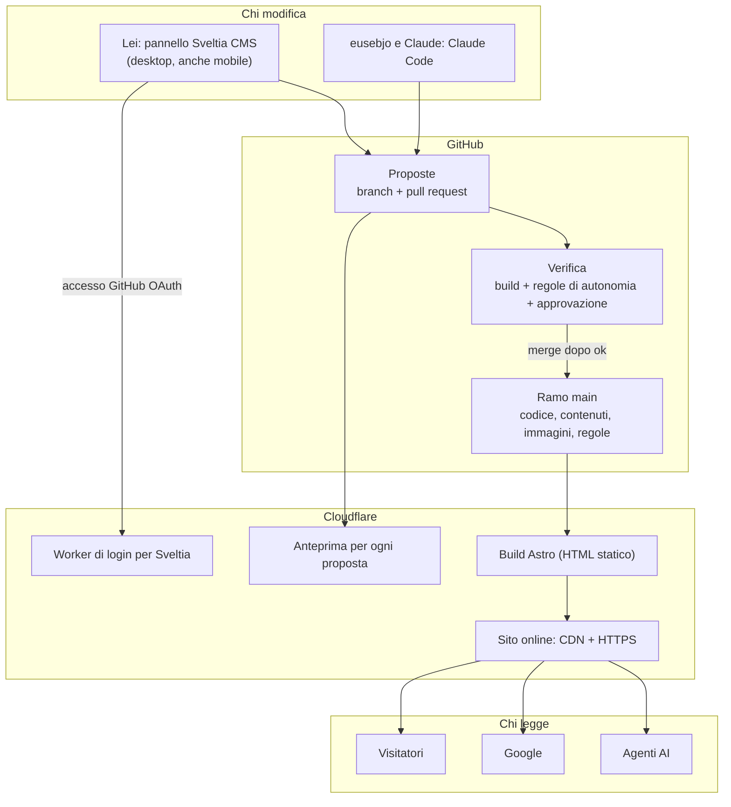

# Alma Living: architettura del sito

- **Data:** 2026-10-19
- **Stato:** approvato da eusebjo il 2026-10-19
- **Ruoli:** eusebjo orchestra il progetto e approva; Claude (via Claude Code) è lo sviluppatore; la compagna di eusebjo gestisce i contenuti del negozio.
- **Ambito di questo documento:** l'architettura tecnica e il modello di governo dei contenuti. Contenuti, sezioni, design e funzioni del sito sono un passo successivo e separato (vedi §11).

---

## 1. Contesto e perché

Alma Living è un negozio fisico di biancheria per la casa in Via Ricasoli 51-53, 57125 Livorno. Serve un sito vetrina.

Requisiti espressi da eusebjo:

- **Controllo totale tramite codice.** Il sito è scritto in codice, versionato, senza CMS classici (WordPress e simili). Sono invece ammessi editor Git-based, che modificano solo i file dei contenuti.
- **SEO ottimizzato, pronto per il mondo agenti, design moderno ed elegante.** Design e contenuti si definiscono dopo.
- **La sua compagna deve essere autonoma** sui contenuti (scrivere testi, pubblicare un post, cambiare un'immagine) attraverso un'interfaccia visuale, senza toccare codice.
- **Autonomia regolabile.** Va da "quasi nulla" a "piena autonomia sui contenuti", per parte del sito e per tipo di azione. La regola eusebjo.
- **Approvazione iniziale.** All'inizio ogni modifica di lei passa dall'approvazione di eusebjo. Dopo l'approvazione il sito si aggiorna da solo.
- **Layout e funzionamento non si possono rompere**, qualunque livello di autonomia lei abbia.
- **Uso da telefono:** è un plus, non un requisito vincolante. Il desktop deve funzionare bene.
- **Riuso:** per ora il progetto è per Alma Living. Il riuso per altri siti è un'ipotesi futura da non precludere.

L'idea centrale è che tutto viva in un unico repository GitHub (codice, contenuti, immagini e regole di autonomia), senza database né server applicativi. Ogni modifica, di chiunque, arriva come proposta, passa da controlli automatici e da un'approvazione, poi va online.

## 2. Obiettivi, non-obiettivi, anti-obiettivi

**Obiettivi (fase 1)**
1. Sito statico in Astro, veloce, semanticamente corretto, ottimizzato per SEO locale e leggibile dagli agenti AI.
2. Pannello visuale (Sveltia CMS) con cui lei modifica i contenuti senza conoscere Git.
3. Ogni modifica di lei diventa una proposta (branch + pull request) con anteprima del sito, e non va mai direttamente online.
4. Regole di autonomia scritte in un file nel repository e verificate automaticamente a ogni proposta. La verifica è imposta da GitHub, quindi non si può aggirare dal pannello.
5. Approvazione di eusebjo prima della pubblicazione, possibile anche dal telefono (app GitHub).
6. Costo di esercizio vicino a zero.
7. Anche lo sviluppo (Claude ed eusebjo) passa dallo stesso flusso: proposta, anteprima, controlli, merge.

**Non-obiettivi (fuori dalla fase 1)**
- Definire contenuti, sezioni, design, funzioni e obiettivi di business del sito: è un passo successivo.
- Agenti in chat (bot WhatsApp o Telegram, connettori MCP per ChatGPT o Gemini), servizio contenuti, agente revisore: sono in fase 2.
- Pannello costruito su misura.
- E-commerce, form contatti, analytics, newsletter, multilingua, pubblicazione programmata.
- Livelli di autonomia con pubblicazione automatica (livelli 2–4, §7): previsti dal modello ma non attivi in fase 1.

**Anti-obiettivi (sarebbe un fallimento anche se "funziona")**
- Una modifica di lei che va online senza essere passata da verifica e approvazione.
- Una modifica di lei che rompe layout, build o SEO tecnica.
- Contenuti che vivono fuori dal repository (database, SaaS), o dipendenza da un editor che non si può sostituire.
- Lei costretta a capire branch, commit o pull request per lavorare.
- Un sito appesantito da JavaScript non necessario o da tracciamenti di terze parti.

## 3. Vincoli

- **Stack:** Astro (output statico) su Cloudflare Workers con Static Assets. Repository su GitHub. Editor Sveltia CMS.
- **Budget:** zero o pochi euro al mese. L'unico costo possibile è GitHub Pro se il repository è privato (§10).
- **Privacy:** sito per un'attività in Italia, quindi GDPR. Nessun tracciamento in fase 1. Font e risorse ospitati in proprio, senza CDN di terzi per i font. Ogni futuro analytics va valutato secondo le linee guida EDPB e del Garante Privacy.
- **Approvazione umana:** nessuna pubblicazione dei contenuti di lei senza l'ok di eusebjo in fase 1.
- **Sviluppatore:** Claude lavora tramite Claude Code su branch e pull request. Nessun push diretto sul ramo principale.

## 4. Architettura: vista d'insieme

**Principio di sicurezza.** Il pannello è solo un modo comodo per creare proposte. La protezione vera è in GitHub: ramo `main` protetto, controlli obbligatori, approvazione obbligatoria. Qualunque canale si aggiunga in futuro (agenti, bot, un altro editor) passa dalle stesse regole senza riscriverle.

## 5. Componenti e scelte

### 5.1 Repository e GitHub
- Un solo repository per sito, contenuti, immagini, regole e documentazione.
- Il ramo `main` è la versione online. Nessuno ci fa push diretti: si entra solo tramite pull request.
- **Protezioni obbligatorie su `main`** (ruleset o branch protection):
  - pull request obbligatoria;
  - almeno 1 approvazione;
  - controlli obbligatori verdi: `build` e `verifica-autonomia`;
  - niente force push né cancellazione.
- GitHub non permette all'autore di approvare la propria pull request, quindi lei non può approvarsi da sola.
- **Le pull request di sviluppo** (Claude ed eusebjo) devono poter essere unite da eusebjo dopo che i controlli passano. Il modo esatto è lasciato al builder (§12), con un vincolo: nessun push diretto su `main` e controlli sempre obbligatori.
- **Notifiche:** `CODEOWNERS` assegna eusebjo come revisore delle proposte, così riceve la notifica via email o app GitHub.
- **Repository pubblico sull'account personale [github.com/eusebjo](https://github.com/eusebjo)** (deciso). Su un repository pubblico protezioni, ruleset, CODEOWNERS e auto-merge sono disponibili con il piano gratuito.
  - Conseguenze accettate: il codice, lo username GitHub di lei e lo storico delle modifiche sono visibili.
  - Nessun segreto va mai nel repository: le credenziali stanno nelle impostazioni di GitHub e dell'hosting.

### 5.2 Sito: Astro statico
- Astro con output completamente statico (nessuna parte generata a ogni richiesta in fase 1).
- Contenuti come [content collections](https://docs.astro.build/en/guides/content-collections/) con schema Zod. **Lo schema Astro è l'autorità**: se un contenuto non lo rispetta la build fallisce, il controllo `build` è rosso e la proposta non si può unire.
- JavaScript solo dove serve (isole). HTML semantico e accessibile.
- Font ospitati nel progetto.

### 5.3 Modello dei contenuti (principi)
Il modello di dettaglio (quali sezioni, quali campi) si definisce con contenuti e design (§11). Principi già decisi:
- Contenuti come file: Markdown con frontmatter per i testi lunghi, JSON o YAML per i dati strutturati (es. impostazioni del negozio: nome, indirizzo, orari, telefono).
- Ogni campo modificabile da lei ha un tipo, dei vincoli (obbligatorio, lunghezza minima e massima, formato) e un ruolo nel layout definito da noi. **Lei compila campi: non impagina.**
- Le immagini sono file nel repository, vicine al contenuto che le usa, referenziate in modo compatibile con l'helper `image()` di Astro.
- La configurazione di Sveltia rispecchia lo schema Astro e non deve permettere valori che lo schema rifiuta (vedi §12 su come tenerle allineate).

### 5.4 Pannello: Sveltia CMS
Scelto dopo il confronto con TinaCMS, Keystatic, CloudCannon, Decap e Pages CMS (fonti in §13). Motivi:
- interfaccia in italiano completa;
- flusso "ogni modifica è una proposta" gratuito;
- ottimizzazione automatica delle foto al caricamento;
- nessuna dipendenza (pagina statica più un piccolo Worker di login);
- usabile anche da telefono;
- licenza MIT, costo zero.

Configurazione richiesta:
- Pannello servito come pagina statica (es. `/admin/`), con la versione di Sveltia **fissata** (rilasci molto frequenti, progetto in beta).
- Backend `github`.
- **Editorial workflow attivo per tutto**: nessuna collection in modalità "simple", nessuna pubblicazione diretta.
- **`publish: false`**: lei non vede il pulsante "Pubblica". Le proposte si uniscono solo su GitHub, dopo l'approvazione.
- Interfaccia in italiano.
- **Trasformazione delle immagini al caricamento:** conversione in WebP, ridimensionamento a una larghezza massima, qualità circa 85, rimozione dei dati Exif, conversione HEIC attiva.
- I campi che lei non deve toccare non compaiono nel pannello. Dove serve vederli e non modificarli, si usa `readonly`. È solo comodità d'interfaccia: la protezione vera è la verifica (§5.6).
- **Piano di riserva:** la configurazione di Sveltia è compatibile con Decap CMS e i contenuti restano file. Se Sveltia si ferma, si cambia editor senza spostare contenuti.

### 5.5 Accesso di lei
- Lei ha un account GitHub gratuito personale, aggiunto come collaboratrice del repository (permesso di scrittura, necessario a Sveltia).
- Accede al pannello con il login GitHub tramite il Worker di autenticazione di Sveltia ([sveltia-cms-auth](https://github.com/sveltia/sveltia-cms-auth)) su Cloudflare, limitato al dominio del sito.
- Da telefono può entrare con il codice QR generato dal pannello sul computer.
- I suoi commit e le sue pull request risultano a suo nome. È così che la verifica la riconosce (§5.6).
- **Fase 2:** quando "Sveltia CMS Additions" (login senza GitHub, ruoli) sarà disponibile, si valuta se adottarlo.

### 5.6 Regole di autonomia e verifica automatica
- **File delle regole** nel repository (es. `autonomia.yml`). Contiene, leggibili da una persona:
  - i ruoli e chi li ha (username GitHub): almeno `redazione` (lei) e `sviluppo` (eusebjo, Claude);
  - per il ruolo `redazione`, per ogni collection, campo e azione (creare, modificare, eliminare, caricare immagini), il livello di autonomia (§7).
- **Controllo `verifica-autonomia`** (GitHub Action su ogni pull request, obbligatorio su `main`). Per le proposte del ruolo `redazione`:
  1. tutti i file toccati devono trovarsi nelle cartelle di contenuti e immagini consentite. Codice, layout, configurazioni, workflow, `autonomia.yml` e configurazione del pannello sono sempre vietati;
  2. per ogni file di contenuto modificato, confronta campo per campo la versione prima e dopo, e ricava le azioni (creazione, modifica, eliminazione);
  3. ogni campo e azione toccati devono avere livello ≥ 1 per il ruolo. Altrimenti il controllo fallisce con un messaggio **in italiano**, comprensibile da lei, che spiega cosa non è consentito;
  4. etichetta la pull request con il livello richiesto (in fase 1 sempre "serve approvazione").
- Per le proposte del ruolo `sviluppo` le regole della redazione non si applicano. Restano obbligatori la build e gli altri controlli tecnici.
- **Autori sconosciuti** (chiunque non compaia in `autonomia.yml`, comprese le pull request da fork se il repository è pubblico): il controllo fallisce sempre. Per queste proposte non si costruiscono anteprime. *(Scelta di Claude)*
- Il file delle regole si cambia solo con una proposta di sviluppo, che eusebjo approva.

### 5.7 Approvazione
- **Quando una proposta è "inviata"** *(scelta di Claude)*:
  - salvare crea una bozza: una pull request in stato draft, non unibile e senza richiesta di revisione;
  - la proposta diventa "da approvare" solo quando lei la sposta nello stato **"In revisione"** del pannello. È l'unico passo esplicito che deve imparare. Così eusebjo non riceve notifiche né approva testi a metà;
  - il controllo `verifica-autonomia` fallisce se la proposta non è in stato "In revisione" o "Pronta". Va verificato in implementazione come Sveltia traduce gli stati sulla pull request (draft ed etichette).
- In fase 1 ogni proposta di lei richiede l'approvazione di eusebjo.
- **eusebjo riceve la notifica** con link alla pull request. Nella pull request trova il link all'anteprima pubblicato da Cloudflare (§5.8). Approva e unisce da web o dall'app GitHub.
- Dopo il merge, Cloudflare ricostruisce e pubblica il sito in automatico.
- **Come lei sa com'è andata** *(scelta di Claude, fase 1)*:
  - il pannello mostra lo stato della proposta;
  - GitHub le manda un'email quando la proposta viene unita, respinta o commentata;
  - ogni messaggio a lei (esito della verifica, commento di eusebjo) è in italiano e scritto in modo che non serva capire Git;
  - per respingere, eusebjo chiude la pull request con un commento; per chiedere correzioni, lascia un commento. Lei corregge dal pannello e la proposta si aggiorna;
  - un canale di notifica dedicato (es. un messaggio sul telefono) è rimandato alla fase 2.
- **Annullamento:** si ripristina la versione precedente con una pull request di revert, che passa dallo stesso flusso. Lo storico Git è il registro completo di chi ha cambiato cosa e quando.

### 5.8 Hosting e anteprime: Cloudflare Workers (deciso 2026-10-19)
Scelto dopo il confronto con Netlify, Vercel, GitHub Pages e hosting europei (Clever Cloud, IONOS Deploy Now, statichost.eu, Bunny). È l'unica opzione che soddisfa tutti i requisiti senza costi:
- uso commerciale consentito;
- anteprima per ogni proposta con link nella pull request;
- servizio di login per Sveltia;
- nessun limite che metta in pausa il sito;
- contratto sul trattamento dei dati (DPA) valido anche sul piano gratuito.

Netlify resta l'alternativa (anteprime più collaudate), ma sul piano gratuito ogni pubblicazione consuma crediti e oltre il tetto il sito va in pausa.

- **Configurazione:** Workers con Static Assets e Workers Builds collegato al repository GitHub; il ramo di produzione è `main`.
  - È l'opzione raccomandata oggi da Cloudflare e dalla guida di Astro per i nuovi progetti. Pages resta supportato ma non riceve nuove funzioni.
- **Anteprime:** build di anteprima attive per tutti i rami non di produzione. Cloudflare commenta la pull request con lo stato e l'URL dell'anteprima.
  - Le anteprime sono pubbliche per URL. Devono avere `noindex` e non essere linkate. Cloudflare Access sulle anteprime è un'opzione futura.
- **Dominio:** dominio personalizzato con HTTPS automatico. Richiede che il DNS del dominio sia gestito da Cloudflare.
- **Altri usi:** lo stesso account ospita il Worker di login di Sveltia (§5.5).
- **Costo:** piano gratuito. L'uso commerciale è consentito. Le richieste agli asset statici sono gratuite e illimitate.
- **Riserva:** se le anteprime dei Workers (lanciate a settembre 2026) creano problemi, si passa a Cloudflare Pages o a Netlify. Vercel è escluso: sul piano gratuito vieta l'uso commerciale.

### 5.9 Immagini
- **Due livelli:**
  1. Sveltia riduce e converte le foto al caricamento, così il repository non si riempie di file da 10–15 MB;
  2. Astro (`astro:assets`, Sharp) genera in build le versioni responsive.
- Ogni immagine di contenuto ha un testo alternativo obbligatorio, imposto dallo schema.

### 5.10 SEO e lettura da agenti
- HTML statico semantico, URL puliti, canonical, meta title e description, Open Graph.
- `sitemap.xml` e `robots.txt`.
- **Dati strutturati schema.org** del negozio (Store o LocalBusiness: nome, indirizzo, telefono, orari, geolocalizzazione) generati dal file delle impostazioni del negozio. Devono essere coerenti con la scheda Google Business Profile.
- `llms.txt` con la descrizione del sito per gli agenti AI.
- `AGENTS.md` con la guida "come si modificano i contenuti" (cartelle, campi, regole). Gli agenti di codice nativi (Codex, Jules, Copilot) la leggono, quindi la porta per la fase 2 resta aperta senza lavoro extra.
- `CLAUDE.md` con le istruzioni di sviluppo per Claude.

### 5.11 Flusso di sviluppo
- Claude lavora su branch dedicati e apre pull request. La proposta riceve anteprima e controlli come quelle di lei. eusebjo la rivede sull'anteprima e unisce.
- Nessuna modifica di sviluppo va online senza passare da questo flusso.

## 6. Flussi passo per passo

**Lei modifica un contenuto**
1. Apre il pannello (`/admin/`) da computer o telefono e accede con GitHub.
2. Modifica i campi (es. un testo o una foto) e salva. Sveltia crea un branch e una bozza di proposta: il sito online non cambia.
3. Cloudflare costruisce l'anteprima e ne pubblica il link nella pull request.
4. Quando ha finito, lei sposta la proposta in "In revisione".
5. Partono (o si aggiornano) i controlli `build` e `verifica-autonomia`. Se una modifica non è consentita, il controllo fallisce con un messaggio in italiano.
6. eusebjo riceve la notifica, guarda l'anteprima, approva e unisce. Oppure commenta o respinge, e lei riceve l'email.
7. Cloudflare ricostruisce il sito: in pochi minuti è online.

**Sviluppo:** Claude apre un branch, poi la pull request. Seguono anteprima e controlli, poi eusebjo rivede e unisce.

**Annullamento:** revert tramite pull request, stesso flusso.

## 7. Livelli di autonomia

| Livello | Significato | Stato |
|---|---|---|
| 0. Bloccato | Lei non lo vede nel pannello; se lo tocca, la verifica respinge la proposta | Fase 1 |
| 1. Serve l'ok | La proposta va online solo dopo l'approvazione di eusebjo | Fase 1 |
| 2. Controllo automatico | Va online se passa le regole e un agente revisore; nel dubbio chiede a eusebjo | Fase 2 |
| 3. Online con avviso | Va online subito; eusebjo riceve un avviso e può annullare | Fase 2 |
| 4. Autonomia piena | Va online subito, senza avviso | Fase 2 |

**Matrice iniziale (fase 1):** tutto ciò che lei può modificare è al livello 1; tutto il resto al livello 0.
- **Livello 0 sempre:** codice, layout, componenti, stili, menu e struttura delle pagine, configurazioni, workflow, regole di autonomia, configurazione del pannello.
- **Livello 0 iniziale:** creazione ed eliminazione di pagine.

La lista concreta dei campi si scrive insieme al modello dei contenuti (§11).

Il file delle regole supporta da subito tutti i livelli 0–4, ma in fase 1 la verifica usa solo 0 e 1. Il caso "orari e chiusure straordinarie" (urgente, poco rischioso) è il primo candidato per il livello 3 in fase 2.

## 8. Fasi

**Fase 1: fondamenta** (le tappe sono in ordine logico; il piano di implementazione le dettaglia)
1. **GitHub:** repository, collaboratrice, protezioni su `main`, CODEOWNERS.
2. **Cloudflare:** scheletro Astro deployato su Workers, produzione da `main`, anteprima per ogni pull request.
   - Fino a quando le pagine reali non sono pronte, il sito vive sull'indirizzo `workers.dev` con `noindex`. Il dominio di produzione si collega solo al lancio vero, e solo allora si pubblicano i dati schema.org reali del negozio. *(Scelta di Claude)*
3. **Pannello:** modello dei contenuti minimo per collaudare il flusso (impostazioni del negozio e una pagina con testo e immagine); Sveltia configurato come in §5.4; Worker di login.
4. **Regole:** `autonomia.yml` e controllo `verifica-autonomia`, entrambi obbligatori su `main`.
5. **SEO e agenti:** dati strutturati, sitemap, robots, `llms.txt`, `AGENTS.md`, `CLAUDE.md`.
6. **Collaudo con lei:** da desktop e da telefono, l'intero giro (proposta, anteprima, approvazione, online, annullamento) più un tentativo di modifica non consentita, che deve essere respinto.

**Dopo la fase 1:** brainstorming separato su contenuti, sezioni, design e funzioni del sito (§11), poi l'implementazione delle pagine reali.

**Fase 2: solo se serve**
- Livelli 2–4 e agente revisore.
- Pubblicazione programmata.
- Agenti in chat (bot WhatsApp con numero dedicato, bot Telegram, connettori MCP quando ChatGPT o Gemini li supporteranno da telefono in Italia) con un servizio contenuti nostro.
- MCP in sola lettura per gli agenti dei visitatori.
- Login senza GitHub (Sveltia Additions).
- Analytics nel rispetto del GDPR.

## 9. Rischi e mitigazioni

| Rischio | Mitigazione |
|---|---|
| Sveltia è in beta, ha un solo sviluppatore e il flusso a proposte è recente (agosto 2026) | Versione fissata; aggiornamenti solo con pull request di sviluppo e collaudo; configurazione compatibile con Decap; contenuti in file indipendenti dall'editor |
| Protezioni GitHub non attive per errore di configurazione | Il collaudo (§8, tappa 6) include un tentativo di modifica non consentita e un tentativo di merge senza approvazione: entrambi devono fallire |
| Le anteprime dei Workers sono recenti | Riserva su Cloudflare Pages o Netlify; il sito statico non dipende dall'host |
| Le anteprime sono pubbliche per URL | `noindex`, nessun link; opzionale Cloudflare Access |
| Account GitHub di lei: attrito iniziale, possibile obbligo di autenticazione a due fattori | Configurazione accompagnata una volta sola; accesso da telefono via QR |
| Le bozze con campi obbligatori vuoti fanno fallire la build della proposta | Comportamento accettato (il controllo rosso blocca solo quella proposta). Il messaggio deve essere chiaro |
| Lo schema Astro e la configurazione Sveltia possono disallinearsi | Lo schema Astro è l'autorità; un controllo o la generazione automatica li tiene allineati (§12) |

## 10. Decisioni aperte (spettano a eusebjo)

**Già decise (2026-10-19)**
- **Sito, dominio ed email:** non esistono. Il sito parte da zero: niente redirect da prevedere e nessuna email da preservare.
- **Repository:** pubblico, su [github.com/eusebjo](https://github.com/eusebjo), account personale di eusebjo.
- **Hosting:** Cloudflare Workers (§5.8). L'account Cloudflare sarà di eusebjo.

- **Accesso operativo di Claude:** Claude esegue le configurazioni di GitHub (`gh`) e Cloudflare (`wrangler`) con credenziali fornite da eusebjo.
  - Le autenticazioni (login a `gh` e `wrangler`, creazione degli account, creazione dell'app OAuth su GitHub) le fa eusebjo di persona.
  - Claude non inserisce né vede password.

**Ancora aperte**
1. **Dominio** (non blocca la fase 1, perché il sito vive su `workers.dev` fino al lancio):
   - quale nome acquistare e presso quale registrar;
   - il DNS va gestito da Cloudflare;
   - da verificare se Cloudflare Registrar vende domini `.it`; altrimenti si acquista presso un registrar italiano e si delegano i nameserver a Cloudflare.

## 11. Fuori da questo documento (passo successivo)

Contenuti e sezioni del sito, obiettivi del sito per il negozio, design (stile, tipografia, immagini), funzioni (contatti, mappa, novità, prodotti in vetrina). Da questi deriva il modello dei contenuti di dettaglio e la lista concreta dei campi per livello di autonomia.

## 12. Lasciato al builder

- Versione di Astro e struttura delle cartelle.
- Formato esatto di `autonomia.yml` e implementazione del controllo `verifica-autonomia` (linguaggio, libreria per i diff dei campi).
- Come tenere allineati lo schema Astro e la configurazione Sveltia: generazione automatica o controllo in CI.
- Come permettere a eusebjo di unire le pull request di sviluppo (bypass per l'amministratore limitato alle pull request, o account separato per Claude), rispettando i vincoli di §5.1.
- Valori precisi di trasformazione delle immagini (larghezza massima, qualità).
- Intestazioni `noindex` per le anteprime e altre intestazioni di sicurezza.
- Prestazioni e accessibilità come controlli in CI (es. Lighthouse), se utili.

## 13. Fonti delle verifiche (consultate il 18 e 19 ottobre 2026)

- **Sveltia CMS:**
  - [interfaccia](https://sveltiacms.app/en/docs/ui.md)
  - [flusso editoriale](https://sveltiacms.app/en/docs/workflows/editorial.md)
  - [GitHub backend](https://sveltiacms.app/en/docs/backends/github.md)
  - [media](https://sveltiacms.app/en/docs/media.md)
  - [Astro](https://sveltiacms.app/en/docs/frameworks/astro.md)
  - [Additions](https://sveltiacms.app/en/docs/additions.md)
- **TinaCMS:** [editorial workflow](https://tina.io/docs/tinacloud/editorial-workflow), [prezzi](https://tina.io/pricing)
- **Cloudflare:**
  - [Workers best practices](https://developers.cloudflare.com/workers/best-practices/workers-best-practices/)
  - [integrazione GitHub](https://developers.cloudflare.com/workers/ci-cd/builds/git-integration/github-integration/)
  - [anteprime](https://developers.cloudflare.com/workers/previews/)
  - [GDPR](https://www.cloudflare.com/trust-hub/gdpr/)
- **Astro:** [deploy su Cloudflare](https://docs.astro.build/en/guides/deploy/cloudflare/)
- **GitHub:**
  - [piani e funzioni](https://docs.github.com/en/get-started/learning-about-github/githubs-plans)
  - [regole disponibili nei ruleset](https://docs.github.com/en/repositories/configuring-branches-and-merges-in-your-repository/managing-rulesets/available-rules-for-rulesets)
- **Vercel:** [fair use, divieto di uso commerciale su Hobby](https://vercel.com/docs/limits/fair-use-guidelines)
- **Canali di fase 2:**
  - [Gemini app personalizzate](https://support.google.com/gemini/answer/17209137)
  - [ChatGPT MCP personalizzati](https://help.openai.com/en/articles/12584461)
  - [prezzi WhatsApp Business Platform](https://developers.facebook.com/documentation/business-messaging/whatsapp/pricing)
